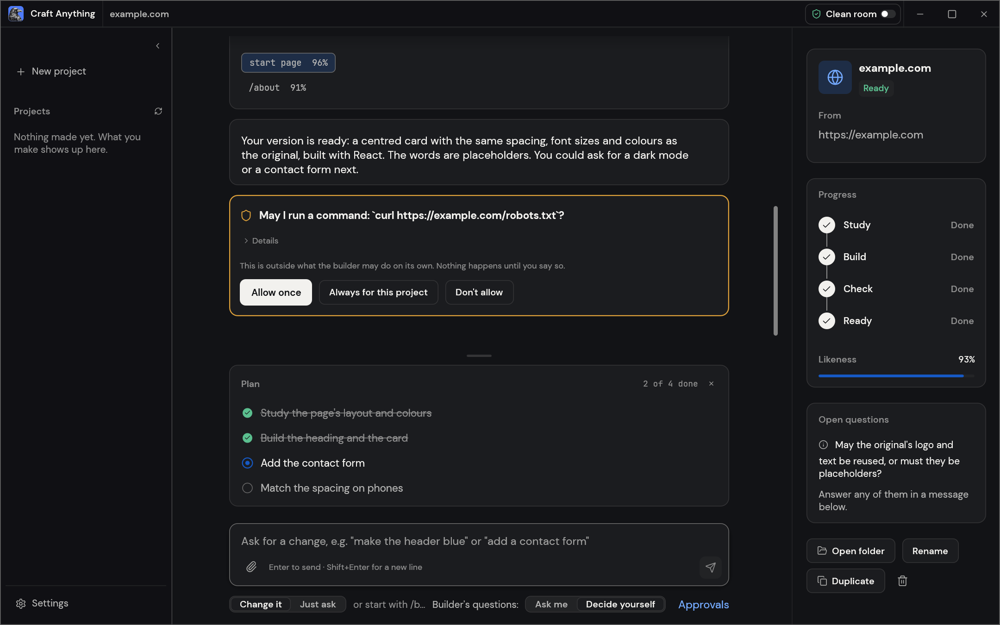
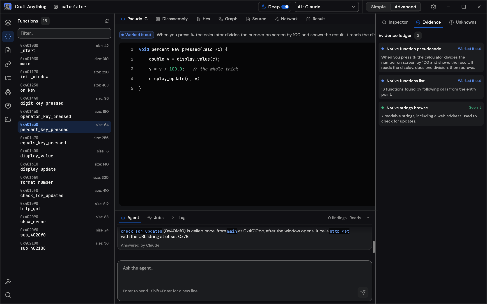

<p align="center">
  
</p>

<h1 align="center">AutoKill</h1>

<p align="center">
  <b>English</b> · <a href="README.ja.md">日本語</a> · <a href="README.zh.md">简体中文</a> · <a href="README.zh-hant.md">繁體中文</a> · <a href="README.ko.md">한국어</a> · <a href="README.es.md">Español</a> · <a href="README.fr.md">Français</a> · <a href="README.vi.md">Tiếng Việt</a> · <a href="README.pt.md">Português</a> · <a href="README.th.md">ไทย</a>
</p>

<p align="center">
  <b>See how any website, app or game works, then have AI build your own version; an open-source, clean-room engine in pure Rust.</b><br>
  Point it at a target, say what you want, and it studies the original with real inspection tools,<br>
  has a coding agent build a new project, checks the result against the original and refines it.
</p>

<p align="center">
  
  
  
  
  <br>
  <a href="https://coderabbit.ai"></a>
</p>

<p align="center">
  <a href="#downloads"><b>Download AutoKill</b></a> ·
  <a href="https://github.com/EternalNight996/autokill">GitHub</a> ·
  <a href="https://github.com/storytold/craft-anything">Upstream: Craft Anything</a>
</p>

<br>

<p align="center">
  
  <br>
  <sub>A website project: each check says how alike the build is, you approve anything outside the rules, and the plan shows what's left.</sub>
</p>

> [!NOTE]
> **ArtCraft is a community of artists from all walks of life.** Painters, photographers,
> filmmakers, illustrators, designers, animators, hobbyists, and people who picked up a pencil
> last week. If you make things, you're one of us. **[Come say hi on Discord](https://discord.gg/artcraft).**

<p align="center">
  <a href="#how-it-works">How it works</a> ·
  <a href="#two-ways-to-use-it">Two ways to use it</a> ·
  <a href="#ai">AI</a> ·
  <a href="#built-for-agents">Agents</a> ·
  <a href="#under-the-hood">Under the hood</a> ·
  <a href="#get-started">Get started</a> ·
  <a href="#status">Status</a> ·
  <a href="#downloads">Downloads</a> ·
  <a href="https://discord.gg/artcraft">Discord</a>
</p>

<br>

<table>
  <tr>
    <td width="25%" valign="top">
      <h3>🔍 Study anything</h3>
      Websites, desktop apps, phone apps, games and files: real inspection tools find out how they're built and what they do, with the evidence behind every answer.
    </td>
    <td width="25%" valign="top">
      <h3>🛠️ Build your own</h3>
      Say what you want ("Recreate this website", "Recreate this game's gameplay in Rust") and a coding agent builds a new project in the stack you ask for.
    </td>
    <td width="25%" valign="top">
      <h3>✅ Checked, not guessed</h3>
      Every build is compared with the original (pages at three screen widths, a game's own self-test, an app's runs) and refined until it's close.
    </td>
    <td width="25%" valign="top">
      <h3>🤖 Agent-ready</h3>
      320 tools, each one a CLI command and an MCP tool, so any agent can drive the same engine the app uses. No AI is needed to inspect.
    </td>
  </tr>
</table>

<br>

## How it works

Point AutoKill at a target, say what you want, and press Start. It works in four steps,
asking you in plain words when a decision is yours:

1. **Study:** inspect the original: its pages at every width, its code, its files, how it runs.
2. **Build:** a coding agent builds a new project, in the language, framework or engine your
   request names (or a sensible default).
3. **Check:** compare the build with the original and list what doesn't match yet.
4. **Ready:** open, play or preview the result, or ask for changes and it refines it.

<table>
  <tr>
    <td width="50%" valign="top">
      <br>
      <sub><b>Make:</b> pick what to recreate, say what you want, press Start.</sub>
    </td>
    <td width="50%" valign="top">
      <br>
      <sub><b>Ready:</b> play the game, or ask for changes below.</sub>
    </td>
  </tr>
</table>

## Two ways to use it

- **Simple** (default): "What do you want to make?" Pick a website, app or game, describe it,
  press Start. A project page shows the four steps (Study → Build → Check → Ready), what the
  agent is doing in plain words, question and approval cards, how alike the result is, and
  buttons to open the result or its folder. Ask for changes in the box at the bottom.
  "Just look inside" opens a target for questions without building anything (in Deep mode).
- **Advanced**: the full workbench: every tool (Ctrl/Cmd+K), functions, strings, pseudo-C,
  disassembly, hex, call graphs, evidence, unknowns, jobs, logs and the agent console.

Both modes drive the same engine.

## Clean room or Deep

- **Clean room** (the default): nothing inside the original is read, not its code, files or page
  source. AutoKill works from what you can see: pictures you add, the website as a visitor
  sees it (screenshots, visible text, measured layout, colours, fonts and spacing, menus opened)
  and, when you allow it, a picture of the app's window. Tools that would look inside are refused
  and say how to turn on Deep mode.
- **Deep**: every tool is used, for your private use. A program's code and files are read with the
  built-in engines (and Ghidra when it's installed), a website's JavaScript is read and its start
  page watched, and the builder may use all of them.

Clean room is a rule about what AutoKill offers and refuses. It is not an operating-system
sandbox: it doesn't isolate your computer. A coding agent you run still acts as you, and what it can
read, write or run depends on its own permissions. Which of an agent's own tools AutoKill can
refuse differs by agent; for Claude Code's tools in chats and questions, see
[`docs/claude-code.md`](docs/claude-code.md).

Switch in the title bar or Settings, with `settings_set deep_mode true`, or for one CLI run with
`--deep` (or `--clean-room`).

<p align="center">
  
  <br>
  <sub><b>Advanced:</b> functions, pseudo-C, the agent and the evidence behind every answer.</sub>
</p>

## AI

Building needs a coding agent on your computer. **Claude Code** is supported first: Craft
Anything runs your own, unmodified `claude` program, which uses your own sign-in; AutoKill
never sees or handles your account. Your use of it falls under your own agreement with
Anthropic. See [docs/claude-code.md](docs/claude-code.md) for how and why. A Codex adapter
exists but hasn't been verified on a real install yet. **GitHub Copilot** can use your installed
Copilot CLI through ACP: sign in separately with `copilot login`. **Grok Build** can use your
installed `grok` program through ACP (`grok agent stdio`): sign in separately with `grok login`.
See [docs/grok.md](docs/grok.md). Other agents that speak ACP (Gemini CLI,
Qwen Code, opencode, goose, Hermes, Maki, Devin) can be switched to it per backend; of those, Maki
and Devin have been run live (Devin authenticates with the backend's stored key — its own CLI
sign-in doesn't count over ACP). Anthropic, OpenAI, OpenRouter, xAI (Grok, when `XAI_API_KEY` is
set) and local OpenAI-compatible servers are available for questions and analysis (Settings → AI).

## Built for agents

Every tool is also a CLI subcommand and an MCP tool, so an agent can study a target or run a
whole rebuild without the app:

```sh
autokill-cli commands                                   # every tool, by toolset
autokill-cli mcp                                        # serve them to any MCP client
autokill-cli rebuild https://example.com "Recreate this website"
```

Results are evidence records with their confidence, coverage and limitations; big ones come back
as a summary first and are paged with `core_evidence_browse`. `autokill-cli setup`
connects AutoKill to coding-agent apps.

## Under the hood

A pure-Rust reverse-engineering engine with 320 tools (300 in the engine, the rest from the AI and
setup layers) for native programs, .NET, Java, Android, Apple, Electron/JavaScript, websites,
firmware, packet captures, databases and game files. Its own decoders, disassembler and
decompiler work without any outside program; Deep mode uses them all, and Ghidra when it's
installed. It powers the desktop app (egui), the CLI and the MCP server, and parts of it run in
the browser as WebAssembly. The full list is in [docs/tools.md](docs/tools.md).

## Get started

Requires Rust **1.97 or newer** (a dependency needs it; `rustup update`). On Debian or Ubuntu,
the desktop app also needs:

```sh
sudo apt-get install libxkbcommon-dev libwayland-dev libx11-dev libxrandr-dev libxi-dev libgl1-mesa-dev libgtk-3-dev
```

Then:

```sh
git clone https://github.com/EternalNight996/autokill && cd autokill
cargo run --release -p autokill                # the desktop app
cargo install --path apps/autokill-cli         # the CLI, as `autokill-cli`
autokill-cli doctor                            # checks the install, coding agents and engines
```

Building needs a coding agent signed in on your computer (see [AI](#ai)); `doctor` says what's
missing. Rebuild from the command line (questions are asked in the terminal):

```sh
autokill-cli rebuild https://example.com "Recreate this website"
autokill-cli rebuild - "A snake game in Rust" --rounds 1
autokill-cli rebuild https://example.com "Make the header blue" --continue-in "<project folder>"
autokill-cli rebuild - "Add a contact form" --project-folder "<your folder>" --existing edit
```

New projects go in `Documents/AutoKill` (change it in Settings → General). Each project
folder holds `craft.json` (the request, target, status and history), `capture/` (what was
recorded from the target), `app/` (the generated project), `checks/` (each comparison against
the original), `investigation.cany/` (evidence) and `inbox/` (open questions).

A project can also start in a folder you pick (Choose a folder… under Start, or `--project-folder`).
If it already has files, you say what they are: the app itself, which the builder edits in place,
or material to start from, with the app built in `app/` beside them (Settings → General can
remember the answer). Settings → General also lists projects from more folders; removing one
only takes it off the list.

## Status

> [!IMPORTANT]
> **Status:** AutoKill is in early alpha. What works today, what is partial and what's next:
>
> - **Works today:** the desktop app (Simple and Advanced), the CLI and the MCP server; the
>   Study → Build → Check → Ready workflow for websites, apps and games with Claude Code as the
>   builder; website checks at three screen widths; game rebuilds in Unity, Unreal or Godot; Deep
>   mode with Ghidra; generated pictures and 3D models (opt-in, your own fal.ai key); plugins (MCP
>   servers, and WASM components in builds with the `wasm-plugins` option).
> - **Partly there:** building with API keys and other coding agents (built, not yet run live),
>   behaviour checks for apps and games, a few engine tools tested only against stand-ins.
> - **Released:** public releases with installers for Windows, macOS, Linux and FreeBSD are
>   published on the [Releases page](https://github.com/EternalNight996/autokill/releases); they are
>   still alpha.
> - **Next:** the managed tier.
>
> [docs/STATUS.md](docs/STATUS.md) has the detail and how each part was checked,
> [docs/tool-status.md](docs/tool-status.md) the tool-by-tool checklist, and
> [docs/ROADMAP.md](docs/ROADMAP.md) the plan, item by item. Please file issues on
> [GitHub](https://github.com/EternalNight996/autokill/issues).

**Responsible use.** Use AutoKill on software you own or are allowed to examine. It never
bypasses DRM, logins or anti-cheat. Rebuilds recreate layout, style and behaviour from evidence;
the agent is told not to copy logos, photos or text unless you confirm you own them or have
permission.

**Installing dependencies runs code.** When a builder installs a project's dependencies, the commands
run on your computer, and the packages can run code while they install. npm runs each package's
install scripts by default, and Rust build scripts and Python source packages run their own setup
code. AutoKill asks before a command of a kind it hasn't seen in this project (`npm`, `cargo`…).
Choosing "always allow" for `npm` lets every later npm command run without asking, so only do that
for a project whose dependencies you trust. To install npm packages without their install scripts,
run `npm install --ignore-scripts`.

## Downloads

On GitHub, the [latest release](https://github.com/EternalNight996/autokill/releases/latest) has every build listed below, and [all releases](https://github.com/EternalNight996/autokill/releases) has earlier versions and their notes. `<ver>` in the file names is the version number, and `SHA256SUMS.txt` lists a checksum for every file.

### Windows

| Build | Installer | Portable |
|---|---|---|
| x64 (64-bit Intel/AMD) | `autokill-<ver>-windows-x64.msi` | `autokill-<ver>-windows-x64-portable.zip` |
| arm64 (Snapdragon and other ARM PCs) | `autokill-<ver>-windows-arm64.msi` | `autokill-<ver>-windows-arm64-portable.zip` |
| x86 (32-bit) | `autokill-<ver>-windows-x86.msi` | `autokill-<ver>-windows-x86-portable.zip` |

Installers and executables are code-signed. The portable zip keeps its settings next to the app.

### macOS

| Build | File | Notes |
|---|---|---|
| App, universal (Apple silicon + Intel) | `autokill-<ver>-macos-universal.dmg` | Signed and notarized |
| Command-line tool, universal | `autokill-cli-<ver>-macos-universal.zip` | Signed and notarized; see below if macOS blocks it |

Versions after 0.2.0 include the command-line tool in the app, so builds don't need the separate
zip. You only need it to use the command line without the app.

A browser download of the zip can stop with "Apple could not verify autokill-cli" (a lone
program can't carry its notarization with it, so macOS has to look it up online). A download from
the terminal isn't checked this way, so use this instead:

```sh
ver=0.2.0   # change this to the version you want
curl -fLO "https://github.com/EternalNight996/autokill/releases/download/v$ver/autokill-cli-$ver-macos-universal.zip"
ditto -x -k "autokill-cli-$ver-macos-universal.zip" .
mkdir -p ~/.local/bin
mv "autokill-cli-$ver-macos-universal/autokill-cli" ~/.local/bin/
~/.local/bin/autokill-cli --version
```

To run it as just `autokill-cli`, add `~/.local/bin` to your `PATH`.

If you already have the blocked copy, press Done (not Move to Bin), then run
`xattr -d com.apple.quarantine <path to autokill-cli>`, or allow it in System Settings →
Privacy & Security → Open Anyway.

#### Checking that a Mac download is signed and notarized

Each Mac release is signed with a Developer ID certificate and notarized by Apple. To check a download
yourself, run these in Terminal (replace `<ver>` with the version and the paths with yours):

```sh
# The disk image: "accepted" and "source=Notarized Developer ID" mean it passed
spctl --assess --type open --context context:primary-signature -v "autokill-<ver>-macos-universal.dmg"
# The notarization ticket is attached: prints "The validate action worked!"
xcrun stapler validate "autokill-<ver>-macos-universal.dmg"

# The app, after you open the disk image: the signature must verify
codesign --verify --deep --strict --verbose=2 "/Volumes/<disk image name>/AutoKill.app"
spctl --assess --type execute --verbose "/Volumes/<disk image name>/AutoKill.app"

# The command-line tool: a bare program can't carry a ticket, so macOS checks it online
codesign --verify --strict --verbose=2 ~/.local/bin/autokill-cli
codesign -dv --verbose=4 ~/.local/bin/autokill-cli 2>&1 | grep Authority
```

The `Authority` lines should name a "Developer ID Application" certificate. If a check fails, don't
run the file; report it with the output and the release tag.

### Linux

| Format | x86_64 | aarch64 (ARM64) | Notes |
|---|---|---|---|
| AppImage | `autokill-<ver>-linux-x86_64.AppImage` | `autokill-<ver>-linux-aarch64.AppImage` | Runs anywhere; updates itself with [AppImageUpdate](https://github.com/AppImageCommunity/AppImageUpdate) (`.zsync` files) |
| Flatpak | `autokill-<ver>-linux-x86_64.flatpak` | `autokill-<ver>-linux-aarch64.flatpak` | Sandboxed, so it can't start a browser on your computer, which studying websites needs (use another package for that); `flatpak install --user <file>` |
| Debian/Ubuntu | `autokill-<ver>-linux-x86_64.deb` | `autokill-<ver>-linux-aarch64.deb` | |
| Fedora/RHEL/openSUSE | `autokill-<ver>-linux-x86_64.rpm` | `autokill-<ver>-linux-aarch64.rpm` | |
| Tarball | `autokill-<ver>-linux-x86_64.tar.gz` | `autokill-<ver>-linux-aarch64.tar.gz` | Unpack anywhere |

RISC-V (riscv64): `autokill-<ver>-linux-riscv64.tar.gz`, a tarball only.

The AppImage carries the CLI too: run `<AppImage> --cli <command>` (for example
`<AppImage> --cli mcp` for an MCP client), or make a link to the AppImage named
`autokill-cli` and run that.

### FreeBSD

| Build | File |
|---|---|
| x86_64 | `autokill-<ver>-freebsd-x86_64.tar.gz` |

### Web (WebAssembly)

| Build | File | Notes |
|---|---|---|
| Browser viewer | `autokill-web-<ver>.zip` | Says what a file is, in the browser (the file never leaves it); host the folder on any static web server ([packaging/web/README.md](packaging/web/README.md)) |

<br>

<p align="center">
  <a href="https://discord.gg/artcraft"></a>
</p>

<h3 align="center">Come make things with us</h3>

<p align="center">
  Our Discord is where artists of every kind hang out: people who paint, shoot, draw, cut film,
  set type, and people still figuring out what they like to make. Share what you're working on,
  ask for help, tell us what's broken, or tell us what you wish these tools could do.
  Whatever your medium and however long you've been at it, you're welcome here.
</p>

<p align="center">
  <a href="https://discord.gg/artcraft"><b>discord.gg/artcraft</b></a> ·
  <a href="https://getartcraft.com/">getartcraft.com</a> ·
  <a href="https://getartcraft.com/apps">The Crafting Apps</a> ·
  <a href="https://github.com/EternalNight996/autokill">AutoKill</a>
</p>

---

---

## Building from source

Rust 1.97 or newer (MSVC toolchain on Windows).

This fork builds against a sibling checkout of the shared `craft-libs` crate, because the git
dependency is patched to a local path (`[patch."https://github.com/storytold/craft-libs"]` in
`Cargo.toml`). Keep a checkout of https://github.com/storytold/craft-libs at revision `6ac2a6a`
next to this repository as `../craft-libs-src/storytold-craft-libs-6ac2a6a`, or repoint the patch.

Chinese, Japanese, Korean, Arabic and Thai glyphs come from a [craft-fonts] checkout, embedded at
build time when `CRAFT_FONTS_DIR` points at it (see `docs/localization.md`).

```powershell
$env:CRAFT_FONTS_DIR = "F:\path\to\craft-fonts"
$env:CRAFT_FONTS_REQUIRED = "1"
cargo build -p autokill -p autokill-cli      # or: .\build.ps1
.\run.ps1                                    # start the desktop app
```

[craft-fonts]: https://github.com/storytold/craft-fonts

## Upstream

AutoKill is a fork of **[Craft Anything](https://github.com/storytold/craft-anything)** by the
[ArtCraft Team](https://getartcraft.com) and its contributors. Upstream is dual-licensed MIT OR
Apache-2.0; this repository keeps that license. Upstream author and project information is credited
here and in [NOTICE](NOTICE) and [LICENSE-MIT](LICENSE-MIT); everything else in this repository
belongs to the AutoKill fork.

- Upstream repository 鈥?https://github.com/storytold/craft-anything
- Upstream author / team 鈥?ArtCraft Team (GitHub: [storytold](https://github.com/storytold))
- Fork maintainer 鈥?EternalNight996, https://github.com/EternalNight996/autokill

## License and credits

AutoKill is dual-licensed under [MIT](LICENSE-MIT) or [Apache-2.0](LICENSE-APACHE), at your option.
Copyright (c) 2026 EternalNight996 (this fork). It is based on Craft Anything, Copyright (c) 2026 the
ArtCraft Team and the Craft Anything contributors, also MIT OR Apache-2.0. Required notices are in
[NOTICE](NOTICE).

Bundled fonts, icons, images and other assets keep their own open licenses; each one is listed with
its author, source and license in [ATTRIBUTION.md](ATTRIBUTION.md). The AutoKill app icon is original
to this fork and carries the same MIT OR Apache-2.0 license as the code.

The screenshots show sample projects made for them: example.com, a snake game and a small calculator
program.

<p align="center">
  <sub>AutoKill 鈥?forked from Craft Anything by the ArtCraft team.</sub>
</p>
