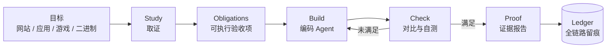

# ⚒️ AutoKili — 证据驱动的复刻引擎

<p align="center"><sub>Evidence in, artifact out · 纯 Rust · 本地优先 · 开源</sub></p>

**AutoKili** 是一个面向「复刻」的工程内核：给它一个目标（网站 / 桌面应用 / 游戏 / 二进制），它先**证明**目标是什么，再把它**造出来**，最后用**证据**验收。

> 本项目是 [Craft Anything](https://github.com/storytold/craft-anything) 的**二创分支**，保留上游全部版权、许可证与致谢。详见 [前身与致谢](#前身与致谢)。

[](#状态)
[](LICENSE-MIT)
[](https://www.rust-lang.org)

---

## 它解决什么

现有工具只做一半：分析工具（REA、Ghidra、IDA）能看懂，但不会写；生成工具能写，但只会"看起来像"。
**AutoKili 补的是中间那一步——把"看懂"翻译成可执行的验收标准。**

```text
证据 ──▶ 义务 ──▶ 重建 ──▶ 证明
(REA)   (可测项)  (Agent)  (双验证)
```

**复刻不是"看起来像"，而是"每一条被证明的事实，都能在重建物里被验证"。**

## 模块

| 模块 | 职责 | 状态 |
| --- | --- | --- |
| Study | 内置 300+ 检查工具（native / .NET / Java / Android / Apple / Electron / 网站 / 固件 / 抓包 / 游戏资源） | 已具备（继承上游） |
| Capture | CDP 站点捕获、多宽度截图、状态捕获、脚本化走查 | 已具备（继承上游） |
| Build | 驱动本机编码 Agent（Claude Code / Codex / Copilot / Grok / ACP 家族）生成项目 | 已具备（继承上游） |
| Check | 三档宽度对比、像素对比、覆盖率、自测 | 已具备（继承上游） |
| Prove | 证据链、义务账本、重建覆盖率 | 规划中（接入 REA） |
| Govern | 指令包注入、席位管理、可回滚配置 | 规划中（接入 gpt6-Astra 工程层） |
| Crawl | 站群抓取、队列、去重、断点续爬 | 规划中 |
| Act | 桌面/浏览器 CUA 操作，人工接管闸门 | 规划中 |

## 快速开始

```bash
git clone https://github.com/EternalNight996/autokili
cd autokili
cargo run --release -p craft-anything      # 桌面应用（重命名进行中）
cargo install --path apps/craft-anything-cli
craft-anything-cli doctor
```

> 重命名尚未落到 crate/二进制层，命令暂沿用上游名称；重命名清单见仓库 Issue。

## 架构



## 不变量

| 不变量 | 由什么保证 |
| --- | --- |
| 证据先于重建 | 每条结论必须带来源与覆盖率 |
| 默认 clean-room | 不读目标内部，除非显式开启 Deep |
| 每次写入可回滚 | 事务化写入 + 内容寻址备份 |
| 未验证不算通过 | 不可验证项单独列出，不混入"通过" |
| 不绕过授权 | 不做 DRM / 登录 / 反作弊绕过 |

## 前身与致谢

**前身：[Craft Anything](https://github.com/storytold/craft-anything)**，作者 [@storytold](https://github.com/storytold) 及全部贡献者。

| 项 | 内容 |
| --- | --- |
| 上游仓库 | https://github.com/storytold/craft-anything |
| 上游作者 | https://github.com/storytold |
| 上游许可证 | MIT OR Apache-2.0 |
| 本分支 | https://github.com/EternalNight996/autokili |

二开声明：

- 本项目 fork 自 Craft Anything，**上游版权与许可证原文完整保留**（见 LICENSE-MIT、LICENSE-APACHE、NOTICE、ATTRIBUTION.md）。
- 上游的第三方声明与 vendored 组件（如 wgpu-hal 的 CRAFT_ANYTHING.md）保持原样，不改标为 AutoKili 原创。
- 本分支的修改集中在品牌、README、后续新增模块；核心引擎的修改会在提交信息中标注来源与理由。

后续计划接入并同样保留署名的上游：

| 上游 | 作者 | 许可证 | 用途 |
| --- | --- | --- | --- |
| [REA](https://github.com/morluto/rea) | morluto 及贡献者 | MIT | 取证与重建验收 |
| [gpt6-Astra](https://github.com/3641397194-wq/gpt6-Astra) | 3641397194-wq | MIT | 指令包与配置治理（仅工程层） |

## 许可

MIT OR Apache-2.0。详见 [LICENSE-MIT](LICENSE-MIT)、[LICENSE-APACHE](LICENSE-APACHE)、[NOTICE](NOTICE)。

## 状态

Early alpha。当前可用：桌面应用、CLI、MCP server、Study → Build → Check 流程。
规划中：义务账本、REA 接入、指令包治理、站群抓取、CUA 行动层。

> 使用范围：仅用于你拥有或获授权检查的软件。禁止用于绕过 DRM、登录或反作弊。
