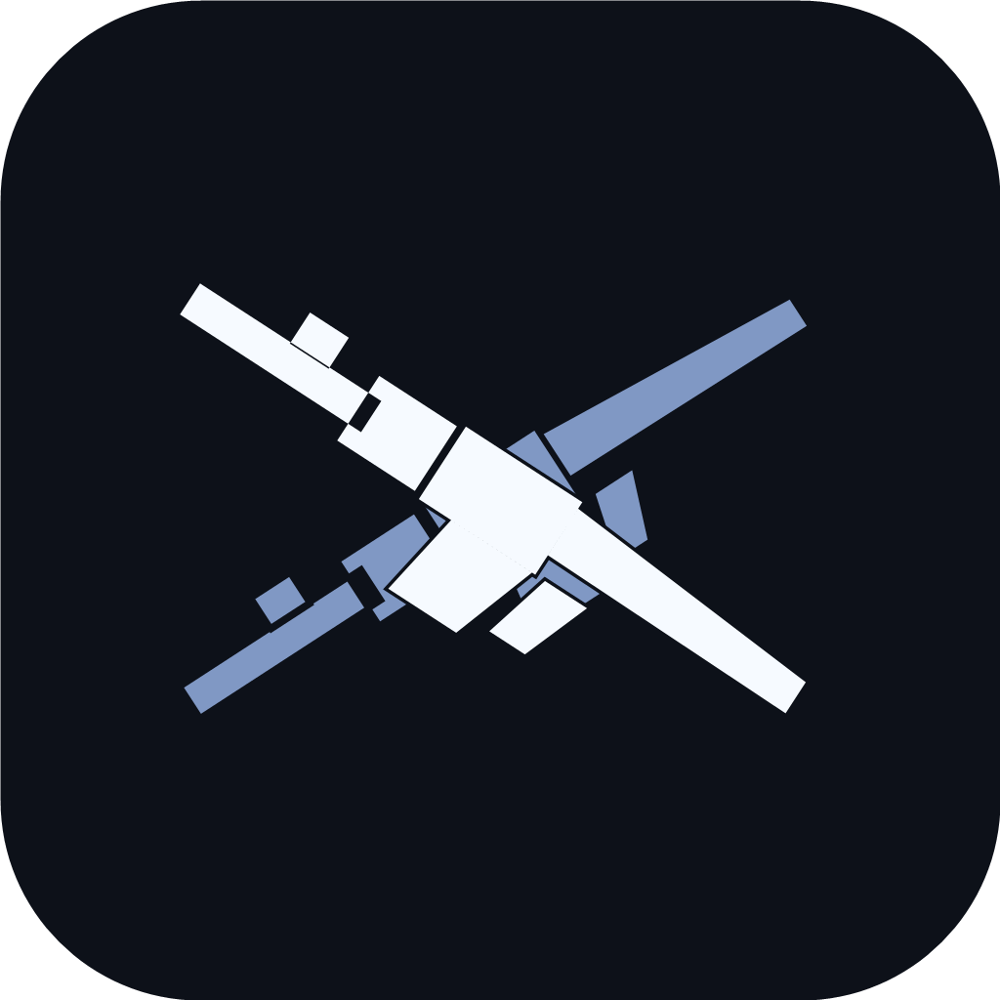
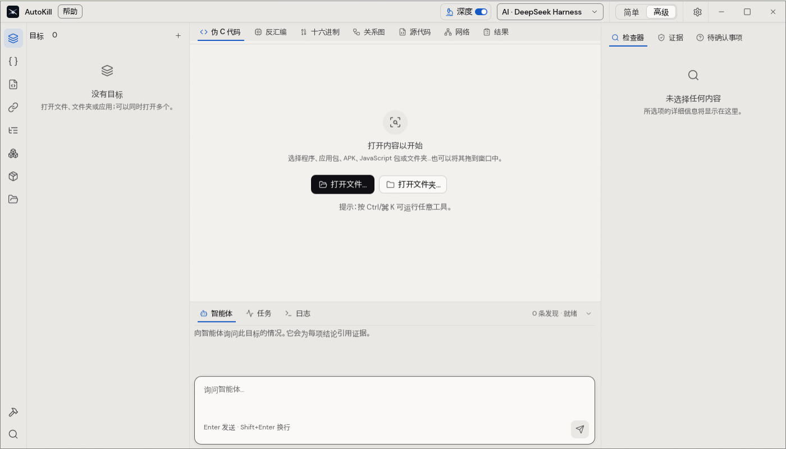
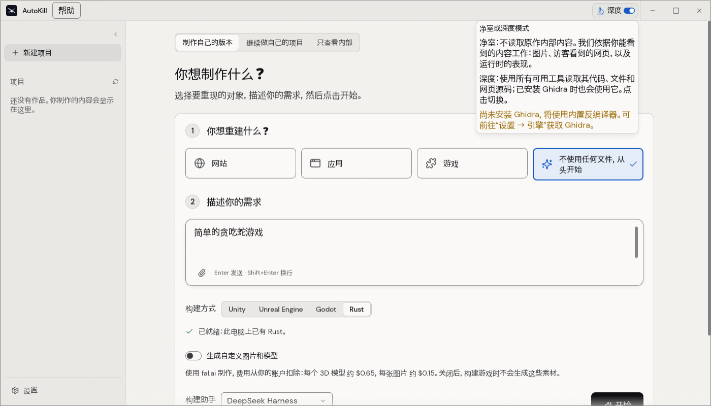

# 🔫 AutoKill — 看清任何软件，再做出一套自己的

<p align="center">
  
</p>

<p align="center">
  
  
</p>
<p align="center"><sub>▲ 真实运行界面：主工作台 · 净室/深度与构建方式（本机实拍，非示意图）</sub></p>

**AutoKill** —— 给它一个程序、一个安装包、一个网页或一款游戏，它用真实工具去看、把每条结论连到证据上，然后让你的 AI 助手照着做一份属于你自己的版本。

本地优先 · 自动取证 · 可核对结论 · 一条引擎供桌面端、命令行与 MCP 共用。

[](NOTICE)
[](Cargo.toml)
[](#-平台兼容)
[](#-开发中)

> 别人给你一个结论，AutoKill 给你一条证据链。

- 🔍 **结论必须带证据** —— 每个判断都写明来源位置、置信度、覆盖范围，以及“没看到什么”。看不清的地方它会说看不清，而不是编一个。
- 🧱 **净室 / 深度，两条边界** —— 净室只按“访客能看到的东西”工作（截图、页面、运行时表现）；深度才读代码、文件与包体。切一下就能对照两种结果。
- 🧠 **看懂之后能重建** —— 研究 → 构建 → 核对 → 交付，四步闭环；构件由你的编码助手动手，AutoKill 负责取证、比对和纠偏。
- 🧩 **一个引擎，四个出口** —— 桌面端、`autokill-cli`、MCP 服务器、Web 查看器共用同一套工具；没有 GUI 也能全流程跑通。
- 🛡 **本地优先** —— 目标文件不出本机；Key 进系统钥匙串；外网只在你要它去取（如网页抓取）时才碰。
- 🇨🇳 **国内模型开箱可选** —— DeepSeek、Moonshot(Kimi)、智谱 GLM、阿里云百炼、火山方舟、MiniMax、百度千帆，设置页里直接贴 Key 即可，不必先设环境变量。

---

## ⚡ 快速开始

**自己编（含中文字体）**

```powershell
# 需要 Rust 1.97+；craft-libs 检出放在 ..\craft-libs-src，craft-fonts 放在 ..\craft-fonts
.\build.ps1          # 等价于 cargo build -p autokill -p autokill-cli
.\run.ps1            # 启动桌面端
```

**命令行 / MCP**

```bash
autokill-cli triage  <目标文件>        # 第一眼体检
autokill-cli chat    <目标> -q "..."  # 就一个目标向智能体提问
autokill-cli rebuild <目标>            # 研究并重建到新工程目录
autokill-cli ai detect                 # 看看本机发现了哪些模型/助手
autokill-cli mcp                       # 以 MCP 服务器运行（stdio）
```

**接进编码助手**：`autokill-cli setup` 会把 MCP 服务器与技能注册进 Claude Code、Codex、DeepSeek Harness 等；`autokill-cli doctor` 告诉你哪一环缺件。

## 🧠 它怎么工作

```text
        ┌──────────── 一条引擎（引擎 / 工具 / 证据）────────────┐
目标 ──▶│ 研究 Study ─▶ 构建 Build ─▶ 核对 Check ─▶ 交付 Ready │──▶ 你的新版本
        └───────────────────────────┬──────────────────────────┘
                                    │ 同一套工具
               桌面端 · CLI · MCP 服务器 · Web 查看器
```

1. **研究**：识别目标类型（PE/ELF/Mach-O/APK/ASAR/网页/Unity/Unreal…），跑内置解析与反汇编，必要时用 Ghidra 补深度分析。
2. **构建**：把需求与证据交给编码助手（Claude Code / Codex / DeepSeek Harness / OpenCode / Copilot…），在 `app/` 里长出一个新工程。
3. **核对**：网站按三种宽度比对、程序行为比对、游戏资源比对；差在哪就指出来。
4. **交付**：留存证据与差异账本，随时回看“为什么这么判断”。

## 🧱 净室与深度

| 模式 | 能看到什么 | 适合 |
|---|---|---|
| **净室 Clean room**（默认） | 只按外部观感工作：截图、页面、运行时表现、用户能看到的界面 | 想做一个“看起来、用起来一样”的东西，但不碰原件内部 |
| **深度 Deep** | 全部工具：读代码、读文件、读包体，装了 Ghidra 就用它 | 自有资产、授权靶场、需要彻底弄明白的场景 |

模式是显式的开关，证据里会记录这次用的哪一档，不会悄悄越界。

## 🖥 平台兼容

| 平台 | 形态 | 说明 |
|---|---|---|
| **Windows** 10/11 x64 | 桌面端 + CLI | MSI/EXE 安装包；图形栈 DX12 → Vulkan → GL 依次回退，驱动崩了还能用软件渲染起来 |
| **macOS** 12+ (arm64 / x64) | 桌面端 + CLI | 公证签名分发；Apple 芯片原生 |
| **Linux** x64 | 桌面端 + CLI | deb / rpm / AppImage / Flatpak；Wayland 优先，X11 回退 |
| **FreeBSD** | CLI | 纯命令行全流程可用 |
| **Web** (WASM) | 只读查看器 | 浏览器里读报告与证据，不出本机 |

要求：Rust 1.97+；深度模式另需 Java + Ghidra（可选，不装也能用内置引擎）。

## ⚖️ 和同类比，差在哪

| | 传统反汇编/反编译套件 | 通用 AI 编程助手 | 单点脚本工具 | AutoKill |
|---|---|---|---|---|
| **起点** | 一个二进制文件 | 一段需求 | 一个具体任务 | 一个真实目标（程序/包/网页/游戏） |
| **结论形态** | 汇编与伪代码，靠人读 | 生成的代码，正确性靠猜 | 一次性输出 | **带位置、置信度、覆盖范围的证据链** |
| **能不能做出来** | 不负责 | 能写代码，但不看原件 | 只看一个点 | 研究→构建→核对闭环，产出可运行工程 |
| **边界控制** | 无 | 无 | 无 | 净室/深度两档显式切换，写进证据 |
| **可复现** | 靠人记录 | 每次不同 | 一次性 | 证据、差异账本、命令与参数都留痕 |
| **落地方式** | 桌面软件 | 云端优先 | 脚本 | 本地优先，桌面/CLI/MCP 三出口 |

一句话：**它不替你“猜”，它替你“看”，看完再让 AI 动手。**

## 📸 实拍

上面两张就是本机跑起来的真实界面。更多界面与逐项能力见 [docs/STATUS.md](docs/STATUS.md) 与 [docs/tool-status.md](docs/tool-status.md)。

## 🧩 The Craft App Suite

| | App | 用途 | 代码 | 了解更多 |
|:-:|---|---|---|---|
|  | **PhotoCraft** | 图像编辑：图层、蒙版、文字与真实 PSD | [GitHub](https://github.com/storytold/photocraft) | [网站](https://getartcraft.com/apps/photocraft) |
|  | **VectorCraft** | 矢量插画 | [GitHub](https://github.com/storytold/vectorcraft) | [网站](https://getartcraft.com/apps/vectorcraft) |
|  | **FilmCraft** | 视频剪辑、调色与声音 | [GitHub](https://github.com/storytold/filmcraft) | [网站](https://getartcraft.com/apps/filmcraft) |
|  | **LightCraft** | 照片库与 RAW 冲印 | [GitHub](https://github.com/storytold/lightcraft) | [网站](https://getartcraft.com/apps/lightcraft) |
|  | **PdfCraft** | 阅读、整理与保护 PDF | [GitHub](https://github.com/storytold/pdfcraft) | [网站](https://getartcraft.com/apps/pdfcraft) |
|  | **EffectCraft** | 动效与视觉特效 | [GitHub](https://github.com/storytold/effectcraft) | [网站](https://getartcraft.com/apps/effectcraft) |
|  | **DesignCraft** | 版式与出版 | [GitHub](https://github.com/storytold/designcraft) | [网站](https://getartcraft.com/apps/designcraft) |
|  | **FigCraft** | 界面设计与原型 | [GitHub](https://github.com/storytold/figcraft) | [网站](https://getartcraft.com/apps/figcraft) |
|  | **WordCraft** | 文字处理与文档 | [GitHub](https://github.com/storytold/wordcraft) | [网站](https://getartcraft.com/apps/wordcraft) |
|  | **SoundCraft** | 录音与音频编辑 | [GitHub](https://github.com/storytold/soundcraft) | [网站](https://getartcraft.com/apps/soundcraft) |
|  | **DeckCraft** | 演示文稿 | [GitHub](https://github.com/storytold/deckcraft) | [网站](https://getartcraft.com/apps/deckcraft) |
|  | **CADCraft** | 计算机辅助设计 | [GitHub](https://github.com/storytold/cadcraft) | [网站](https://getartcraft.com/apps/cadcraft) |
|  | **GridCraft** | 表格与数据 | [GitHub](https://github.com/storytold/gridcraft) | [网站](https://getartcraft.com/apps/gridcraft) |
|  | **TextureCraft** | 3D 贴图绘制 | [GitHub](https://github.com/storytold/texturecraft) | [网站](https://getartcraft.com/apps/texturecraft) |
|  | **MaterialCraft** | 节点式程序化材质 | [GitHub](https://github.com/storytold/materialcraft) | [网站](https://getartcraft.com/apps/materialcraft) |
|  | **AutoKill** | 看清任何软件，然后做出自己的 | [GitHub](https://github.com/EternalNight996/autokill) | 本仓库 |
|  | **CoreTempCraft** ⟲ | CPU 频率与温度实时监控（Windows）· 用 AutoKill 复刻 | [GitHub](https://github.com/EternalNight996/coretempcraft) | |
|  | **ObsidianCraft** ⟲ | 本地 vault + 关系图的笔记应用 · 用 AutoKill 复刻 | [GitHub](https://github.com/EternalNight996/obsidiancraft) | |
|  | **SolidCraft** | 参数化 3D CAD（社区应用，Tangency Labs） | [GitHub](https://github.com/tangency-labs/solidcraft) | |

<sub>⟲ 标记的两个应用是用 AutoKill 复刻出来的实例（非上游 ArtCraft 出品），源码与截图都在各自仓库里。</sub>

## 🛠 开发中

| 代号 | 在做什么 |
|---|---|
| **REA** | 把“看见”推进到“看懂”：从散落的事实里推回设计意图，给出可复核的推理链 |
| **CUA** | 让智能体直接坐到操作台前：看屏幕、动鼠标、敲键盘，人手能做的界面操作它也能做 |
| **MengBot** | 把同一条引擎接到聊天机器人上，让它在你常用的聊天窗口里干活 |
| **page-agent** | 网页侧的自动巡检与操作代理：按流程走页面、取所需，不靠人肉复制粘贴 |
| **autokill-pure** | **参悟天机 · 推演阵法 · 破障解禁**：在自有资产与授权靶场里，参详一处机枢如何运转，推演它的阵图与关卡，再循理而解、据证而立。讲的是“通透”，不是“破坏”——具体法门在正文之外，只对合规场景开放 |

> 以上均在开发中，接口与行为会变；能力与验证情况以 [docs/STATUS.md](docs/STATUS.md) 为准。

## 🙏 上游与致谢

AutoKill 是 **[Craft Anything](https://github.com/storytold/craft-anything)** 的二创分支，上游由 **ArtCraft Team**（GitHub: [storytold](https://github.com/storytold)）与众多贡献者写成。没有他们打的地基，就没有这个分支。

- 上游仓库：https://github.com/storytold/craft-anything
- 上游作者 / 团队：ArtCraft Team（storytold）
- 上游许可：MIT OR Apache-2.0（本仓库沿用同一许可）
- 本项目维护者：EternalNight996 · https://github.com/EternalNight996/autokill

字体、图标等第三方素材的逐项来源与许可见 [ATTRIBUTION.md](ATTRIBUTION.md)；上游版权声明见 [NOTICE](NOTICE) 与 [LICENSE-MIT](LICENSE-MIT)。

## 📄 许可证

双许可：[MIT](LICENSE-MIT) 或 [Apache-2.0](LICENSE-APACHE)，任选其一。
Copyright (c) 2026 EternalNight996（本分支）；基于 Craft Anything，Copyright (c) 2026 the ArtCraft Team and the Craft Anything contributors。

<p align="center"><sub>AutoKill — 看清，然后做出来。</sub></p>
